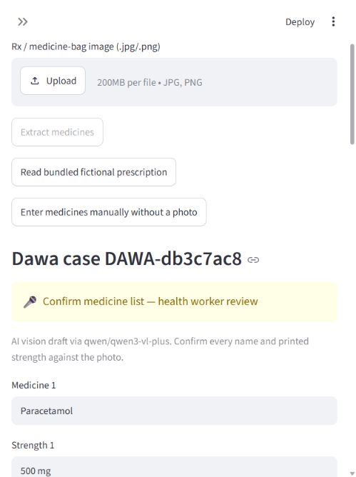
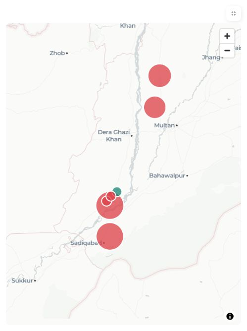

# SmartSehat

[](https://github.com/Azharhp/Smart-Sehat-Agentic-AI/actions/workflows/offline-tests.yml)

SmartSehat is a research prototype for health-worker-assisted remote consultation in rural Pakistan. It combines **deterministic-first emergency screening**, **auditable LangGraph workflows with human approval**, and **source-linked medication safety flags**. A worker confirms captured facts; a remote doctor reviews the packet and enters the care plan.

**Synthetic cases only. This is not a validated medical device or a service for real patient care.** Clinical rules, dosing data, language accuracy and deployment controls require independent review. Delivery, transport and clinician identity are simulated unless explicitly integrated; configured credentials do not establish service availability.

## Why this project matters to open-source developers

Developers can reproduce offline software regressions, study checkpointed human approval, adapt the audit and task infrastructure to nonclinical workflows, and improve multilingual accessibility without using patient data. Authored vignettes test implementation consistency, not clinical accuracy or patient outcomes. See [architecture](docs/consultation_architecture.md) and the [clinical content register](docs/clinical_content_register.md).

## Implemented workflows

- **Consultation:** consent, age-aware danger screening, story capture, confirmed AI proposals, adaptive questions, measurements, medicine/allergy reconciliation, SBAR packet, read-back and handoff.
- **Doctor console:** queued cases, acknowledgement, additional observations, provisional/final replies, doctor-entered prescriptions, referrals and follow-up.
- **Dawa Check:** optional prescription-image extraction, mandatory worker correction/confirmation and ingredient/class safety flags. No automatic prescribing or dose approval.
- **District dashboard:** combined encounter totals, filters, CSV export and aggregated illustrative location map. Unknown locations remain counted and unmapped; coordinates are not patient GPS.
- **Continuity:** encrypted local encounter payloads and checkpoints; separate browser safety capture with manual import, not full offline synchronization.

## Two preserved entry points

The completed consultation build runs from `smartsehat_workspace/app.py`. The existing upstream app remains at `smartsehat/app.py`, with its identity, medication and intake safeguards and regression tests intact. These are separate application paths and are not yet a single unified security architecture. Both are prototypes; do not infer that upstream access controls protect the new workspace.

## Quick start

Use Python 3.12 or newer and an isolated environment:

```sh
python -m venv .venv
# Linux/macOS
. .venv/bin/activate
# Windows PowerShell: .\.venv\Scripts\Activate.ps1
python -m pip install -r requirements.txt
python -m streamlit run smartsehat_workspace/app.py --server.address 127.0.0.1
```

Open http://127.0.0.1:8501. Manual/stub workflows require no provider keys. Optional live operations use server-side credentials described in `config.workspace.yaml`; see [.env.consultation.example](.env.consultation.example). Never commit `.env`, databases, encryption keys, recordings or uploads. Keep the server on localhost: this prototype lacks production authentication and verified doctor identity.

Dawa Check: choose **Read bundled fictional prescription**, review every extracted name/strength, then **Confirm & check**. Live image extraction needs a reachable configured provider; manual entry remains available. Generated prompt recordings are local encrypted artifacts and are not shipped; see [audio preparation](docs/danger_screen_completion.md).

## Reproduce offline checks

```sh
python -m unittest discover -s tests -p 'test_*.py' -v
python -m unittest discover -s tests_workspace -p 'test_*.py' -v
python test_flow.py
python test_dawa.py
node tests_workspace/browser_components.cjs
node tests_workspace/danger_component.cjs
node tests_workspace/speech_component.cjs
```

Disable dotenv/provider access for offline runs as described in [CONTRIBUTING.md](CONTRIBUTING.md). Historical results are in [verification](docs/verification.md); current CI status is shown above. Live provider availability is checked separately and is not guaranteed by offline tests.

## Demo and development





Use the [two fictional case walkthrough](finale/TWO-CASES.md). Screenshots and saved walkthroughs are synthetic snapshots, not evidence of deployed usage. See [contributing](CONTRIBUTING.md), [security](SECURITY.md), [roadmap](ROADMAP.md), [changelog](CHANGELOG.md), and [third-party rights](THIRD_PARTY_NOTICES.md).

## Limits and licensing

No clinical sign-off, reviewed dosing catalogue, real delivery integration or field validation is claimed. Regional speech remains experimental and human confirmation is required. Exports contain readable information; local encryption is not a substitute for deployment access control.

Original project code is licensed under [Apache-2.0](LICENSE). Third-party clinical passages and media retain their own rights and must not be assumed Apache-licensed. See [third-party notices](THIRD_PARTY_NOTICES.md).
